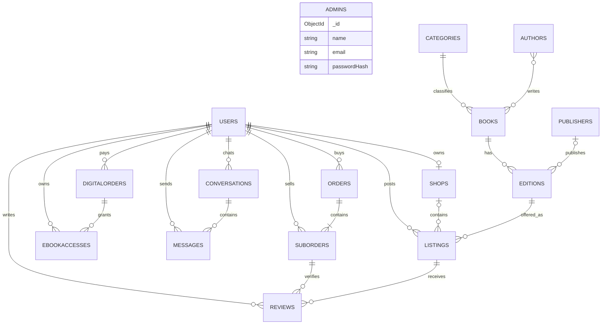
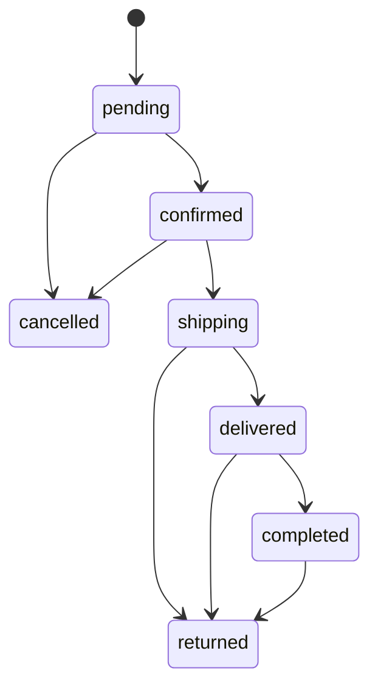

# Cấu trúc database BookMarket

| Collection | Bản ghi | Field |
|---|---:|---:|
| admins | 1 | 7 |
| authors | 68 | 7 |
| banktransactions | 0 | 8 |
| books | 91 | 10 |
| categories | 5 | 6 |
| conversations | 2 | 16 |
| digitalorders | 0 | 18 |
| ebookaccesses | 0 | 8 |
| editions | 92 | 9 |
| listings | 216 | 18 |
| messages | 1 | 11 |
| notifications | 0 | 10 |
| orders | 4 | 13 |
| publishers | 6 | 6 |
| reviews | 0 | 11 |
| shops | 27 | 13 |
| suborders | 4 | 13 |
| users | 77 | 9 |

## admins

1 bản ghi.

| Field | Kiểu | Trong model | Ý nghĩa |
|---|---|---|---|
| __v | int | Có | Phiên bản nội bộ Mongoose |
| _id | objectId | Có | ID bản ghi |
| createdAt | date | Có | Thời điểm tạo |
| email | string | Có | Email duy nhất |
| name | string | Có | Tên tài khoản/gian hàng |
| passwordHash | string | Có | Mật khẩu đã băm bcrypt |
| updatedAt | date | Có | Thời điểm sửa |

## authors

68 bản ghi.

| Field | Kiểu | Trong model | Ý nghĩa |
|---|---|---|---|
| __v | int | Có | Phiên bản nội bộ Mongoose |
| _id | objectId | Có | ID bản ghi |
| biography | string | Có | Giới thiệu tác giả |
| createdAt | date | Có | Thời điểm tạo |
| name | string | Có | Tên tài khoản/gian hàng |
| nameSearch | string | Có | Tên không dấu để tìm kiếm |
| updatedAt | date | Có | Thời điểm sửa |

## banktransactions

0 bản ghi.

| Field | Kiểu | Trong model | Ý nghĩa |
|---|---|---|---|
| _id | ObjectId | Có | ID bản ghi |
| amount | Number | Có |  |
| createdAt | Date | Có | Thời điểm tạo |
| description | String | Có | Mô tả |
| orderId | ObjectId | Có | Đơn mẹ của đơn con |
| reason | String | Có | Lý do giao dịch ngân hàng chưa khớp |
| resolved | Boolean | Có | Giao dịch chưa khớp đã được xử lý |
| transactionId | String | Có | ID giao dịch ngân hàng dùng đối soát, unique |

## books

91 bản ghi.

| Field | Kiểu | Trong model | Ý nghĩa |
|---|---|---|---|
| __v | int | Có | Phiên bản nội bộ Mongoose |
| _id | objectId | Có | ID bản ghi |
| authorIds | array | Có | Danh sách tác giả |
| catalogKey | string | Có | Khóa chống tạo trùng tác phẩm |
| categoryId | objectId | Có | Thể loại tác phẩm |
| createdAt | date | Có | Thời điểm tạo |
| description | string | Có | Mô tả |
| title | string | Có | Tên tác phẩm |
| titleSearch | string | Có | Tên sách không dấu để tìm kiếm |
| updatedAt | date | Có | Thời điểm sửa |

## categories

5 bản ghi.

| Field | Kiểu | Trong model | Ý nghĩa |
|---|---|---|---|
| __v | int | Có | Phiên bản nội bộ Mongoose |
| _id | objectId | Có | ID bản ghi |
| createdAt | date | Có | Thời điểm tạo |
| name | string | Có | Tên tài khoản/gian hàng |
| nameSearch | string | Có | Tên không dấu để tìm kiếm |
| updatedAt | date | Có | Thời điểm sửa |

## conversations

2 bản ghi.

| Field | Kiểu | Trong model | Ý nghĩa |
|---|---|---|---|
| __v | int | Có | Phiên bản nội bộ Mongoose |
| _id | objectId | Có | ID bản ghi |
| book | object | Không |  |
| book.author | String | Có |  |
| book.listingId | String | Có |  |
| book.title | String | Có |  |
| buyerId | objectId | Có | User mua hàng |
| buyerReadSequence | int | Có |  |
| createdAt | date | Có | Thời điểm tạo |
| lastMessageAt | date | Có |  |
| lastSequence | int | Có |  |
| lastText | string | Có |  |
| nextSequence | int | Có |  |
| sellerId | objectId | Có | User đăng tin |
| sellerReadSequence | int | Có |  |
| updatedAt | date | Có | Thời điểm sửa |

## digitalorders

0 bản ghi.

| Field | Kiểu | Trong model | Ý nghĩa |
|---|---|---|---|
| _id | ObjectId | Có | ID bản ghi |
| bank.accountName | String | Có |  |
| bank.accountNo | String | Có |  |
| bank.id | String | Có |  |
| bank.name | String | Có |  |
| bankTransactionId | String | Có | ID giao dịch ngân hàng, unique và sparse |
| buyerId | ObjectId | Có | User mua hàng |
| cartKey | String | Có | Khóa bộ listingIds để dùng lại đơn đang chờ |
| createdAt | Date | Có | Thời điểm tạo |
| expiresAt | Date | Có | Thời điểm đơn hoặc phiên hết hạn |
| items | Array | Có | Snapshot tên/giá; đơn giấy có type/isbn/quantity, đơn ebook có editionId/sellerId |
| paidAmount | Number | Có | Số tiền thực nhận đã xác minh |
| paidAt | Date | Có | Thời điểm server xác nhận đã thanh toán |
| qrImageUrl | String | Có | Link ảnh VietQR từ server |
| status | String | Có | Trạng thái tin hoặc đơn; xem DATA_MODEL.md cho enum tương ứng |
| total | Number | Có | Tổng tiền sách và phí giao |
| transferCode | String | Có | Mã BM và 10 chữ/số dùng khớp nội dung chuyển khoản |
| updatedAt | Date | Có | Thời điểm sửa |

## ebookaccesses

0 bản ghi.

| Field | Kiểu | Trong model | Ý nghĩa |
|---|---|---|---|
| _id | ObjectId | Có | ID bản ghi |
| buyerId | ObjectId | Có | User mua hàng |
| createdAt | Date | Có | Thời điểm tạo |
| digitalOrderId | ObjectId | Có | Đơn ebook đã thanh toán cấp quyền sở hữu |
| editionId | ObjectId | Có | Phiên bản của tin bán |
| grantedAt | Date | Có | Thời điểm cấp quyền sở hữu ebook |
| listingId | String | Có | Tin sách đã mua và được đánh giá |
| updatedAt | Date | Có | Thời điểm sửa |

## editions

92 bản ghi.

| Field | Kiểu | Trong model | Ý nghĩa |
|---|---|---|---|
| __v | int | Có | Phiên bản nội bộ Mongoose |
| _id | objectId | Có | ID bản ghi |
| binding | string | Có | Loại bìa hoặc PDF |
| bookId | objectId | Có | Tác phẩm của phiên bản |
| createdAt | date | Có | Thời điểm tạo |
| isbn | string | Có | Mã phiên bản, unique khi có giá trị |
| publisherId | objectId | Có | Nhà xuất bản phiên bản |
| updatedAt | date | Có | Thời điểm sửa |
| year | int | Có | Năm xuất bản |

## listings

216 bản ghi.

| Field | Kiểu | Trong model | Ý nghĩa |
|---|---|---|---|
| __v | int | Có | Phiên bản nội bộ Mongoose |
| _id | string | Có | ID bản ghi |
| condition | string | Có | Tình trạng sách |
| createdAt | date | Có | Thời điểm tạo |
| description | string | Có | Mô tả |
| ebookFileId | String | Có | ID file PDF lưu riêng tại backend/storage, không trả công khai qua API JSON |
| ebookPageCount | Number | Có | Số trang PDF đã kiểm tra khi upload |
| editionId | objectId | Có | Phiên bản của tin bán |
| hiddenBy | String | Có | Tin do seller hay admin ẩn |
| images | Array | Có | Tối đa 5 ảnh JPEG/PNG/WebP; database chỉ lưu ID tệp và contentType |
| location | string | Có | Địa điểm |
| price | int | Có | Giá bán |
| sellerId | objectId | Có | User đăng tin |
| shopId | objectId / null | Có | Shop của tin, có thể null |
| status | string | Có | Trạng thái tin hoặc đơn; xem DATA_MODEL.md cho enum tương ứng |
| stock | int | Có | Số lượng |
| type | string | Có | new/used/digital |
| updatedAt | date | Có | Thời điểm sửa |

## messages

1 bản ghi.

| Field | Kiểu | Trong model | Ý nghĩa |
|---|---|---|---|
| __v | int | Có | Phiên bản nội bộ Mongoose |
| _id | objectId | Có | ID bản ghi |
| clientId | string | Có | Mã chống gửi trùng tin nhắn |
| conversationId | objectId | Có | Cuộc trò chuyện chứa tin nhắn |
| createdAt | date | Có | Thời điểm tạo |
| readAt | null | Có | Thời điểm người nhận đọc tin, null nếu chưa đọc |
| recipientId | objectId | Có | User nhận tin trong cuộc trò chuyện |
| senderId | objectId | Có | User gửi tin, lấy từ JWT |
| sequence | int | Có | Thứ tự tin nhắn trong cuộc trò chuyện |
| text | string | Có |  |
| updatedAt | date | Có | Thời điểm sửa |

## notifications

0 bản ghi.

| Field | Kiểu | Trong model | Ý nghĩa |
|---|---|---|---|
| _id | ObjectId | Có | ID bản ghi |
| createdAt | Date | Có | Thời điểm tạo |
| message | String | Có | Nội dung thông báo thay đổi trạng thái đơn |
| orderId | ObjectId | Có | Đơn mẹ của đơn con |
| readAt | Date | Có | Thời điểm người nhận đọc tin, null nếu chưa đọc |
| status | String | Có | Trạng thái tin hoặc đơn; xem DATA_MODEL.md cho enum tương ứng |
| subOrderId | ObjectId | Có | Đơn con completed chứng minh người mua được đánh giá |
| title | String | Có | Tên tác phẩm |
| updatedAt | Date | Có | Thời điểm sửa |
| userId | ObjectId | Có | User sở hữu bản ghi |

## orders

4 bản ghi.

| Field | Kiểu | Trong model | Ý nghĩa |
|---|---|---|---|
| _id | objectId | Có | ID bản ghi |
| buyerId | objectId | Có | User mua hàng |
| createdAt | date | Có | Thời điểm tạo |
| idempotencyKey | string | Có | Mã chống đặt trùng; unique cùng buyerId |
| itemsTotal | int | Có | Tổng tiền sách snapshot |
| paymentMethod | string | Có | Phương thức thanh toán, hiện chỉ cod |
| receiverAddress | string | Có | Địa chỉ nhận hàng |
| receiverName | string | Có | Họ tên người nhận |
| receiverPhone | string | Có | Số điện thoại nhận hàng |
| requestHash | string | Có | SHA-256 nội dung đặt hàng đã chuẩn hóa để kiểm tra gửi lại |
| shippingTotal | int | Có | Tổng phí của các đơn con |
| total | int | Có | Tổng tiền sách và phí giao |
| updatedAt | date | Có | Thời điểm sửa |

## publishers

6 bản ghi.

| Field | Kiểu | Trong model | Ý nghĩa |
|---|---|---|---|
| __v | int | Có | Phiên bản nội bộ Mongoose |
| _id | objectId | Có | ID bản ghi |
| createdAt | date | Có | Thời điểm tạo |
| name | string | Có | Tên tài khoản/gian hàng |
| nameSearch | string | Có | Tên không dấu để tìm kiếm |
| updatedAt | date | Có | Thời điểm sửa |

## reviews

0 bản ghi.

| Field | Kiểu | Trong model | Ý nghĩa |
|---|---|---|---|
| _id | ObjectId | Có | ID bản ghi |
| buyerId | ObjectId | Có | User mua hàng |
| comment | String | Có | Nhận xét người mua, trim và tối đa 2000 ký tự |
| createdAt | Date | Có | Thời điểm tạo |
| listingId | String | Có | Tin sách đã mua và được đánh giá |
| orderId | ObjectId | Có | Đơn mẹ của đơn con |
| rating | Number | Có | Điểm đánh giá thật từ người mua: số nguyên 1 đến 5 |
| reply | Embedded | Có | Phản hồi công khai của người bán cho đánh giá |
| sellerId | ObjectId | Có | User đăng tin |
| subOrderId | ObjectId | Có | Đơn con completed chứng minh người mua được đánh giá |
| updatedAt | Date | Có | Thời điểm sửa |

## shops

27 bản ghi.

| Field | Kiểu | Trong model | Ý nghĩa |
|---|---|---|---|
| __v | int | Có | Phiên bản nội bộ Mongoose |
| _id | objectId | Có | ID bản ghi |
| contactEmail | string | Có | Email liên hệ của shop |
| contactName | string | Có | Tên người liên hệ riêng tư của shop |
| contactPhone | string | Có | Số điện thoại liên hệ của shop |
| createdAt | date | Có | Thời điểm tạo |
| description | string | Có | Mô tả |
| isRegistrationComplete | boolean | Có | Hồ sơ shop đã đủ và hợp lệ để đăng sách mới/ebook |
| name | string | Có | Tên tài khoản/gian hàng |
| ownerId | objectId | Có | User sở hữu shop |
| pickupAddress | object | Có | Địa chỉ lấy/trả hàng: province, ward, detail |
| registrationCompletedAt | date | Có | Thời điểm hoàn tất hồ sơ shop do server đặt |
| updatedAt | date | Có | Thời điểm sửa |

## suborders

4 bản ghi.

| Field | Kiểu | Trong model | Ý nghĩa |
|---|---|---|---|
| _id | objectId | Có | ID bản ghi |
| buyerId | objectId | Có | User mua hàng |
| cancelReason | string | Có | Lý do hủy, bước đặt hàng để rỗng |
| createdAt | date | Có | Thời điểm tạo |
| items | array | Có | Snapshot tên/giá; đơn giấy có type/isbn/quantity, đơn ebook có editionId/sellerId |
| itemsTotal | int | Có | Tổng tiền sách snapshot |
| orderId | objectId | Có | Đơn mẹ của đơn con |
| sellerId | objectId | Có | User đăng tin |
| shipment | object | Có | Dịch vụ, phí, mã vận đơn và các sự kiện |
| shippingFee | int | Có | Phí cố định của đơn con |
| shopName | string | Có | Tên shop hoặc người bán tại lúc đặt |
| status | string | Có | Trạng thái tin hoặc đơn; xem DATA_MODEL.md cho enum tương ứng |
| updatedAt | date | Có | Thời điểm sửa |

## users

77 bản ghi.

| Field | Kiểu | Trong model | Ý nghĩa |
|---|---|---|---|
| __v | int | Có | Phiên bản nội bộ Mongoose |
| _id | objectId | Có | ID bản ghi |
| addresses | Array | Có | Tối đa 3 địa chỉ nhận hàng lưu theo tài khoản |
| createdAt | date | Có | Thời điểm tạo |
| email | string | Có | Email duy nhất |
| favorites | Array | Có | Danh sách ID tin sách yêu thích của tài khoản |
| name | string | Có | Tên tài khoản/gian hàng |
| passwordHash | string | Có | Mật khẩu đã băm bcrypt |
| updatedAt | date | Có | Thời điểm sửa |

# Database BookMarket — catalog và đơn hàng

BookMarket hiện có 19 collection. Tài khoản admin nằm riêng, không lưu role trong users/admins. Mọi collection có `_id`; các model nghiệp vụ mới dùng `versionKey=false`.

| Collection | Trường nghiệp vụ | Quan hệ / ràng buộc |
|---|---|---|
| users | name, email, passwordHash, addresses[], favorites[] | email unique; tối đa 3 địa chỉ nhận hàng, 500 ID tin yêu thích. |
| admins | name, email, passwordHash | email unique trong admins; chỉ seed/migration tạo admin. |
| shops | ownerId, name, description, contactName, contactPhone, contactEmail, pickupAddress, isRegistrationComplete, registrationCompletedAt | ownerId → users, unique; mỗi user tối đa một shop. Liên hệ/địa chỉ riêng tư; new/digital cần hồ sơ hoàn tất. Không lưu tài khoản ngân hàng shop. |
| authors | name, biography | nameSearch phục vụ tìm không dấu và tái sử dụng tên. |
| publishers | name | nameSearch phục vụ tìm không dấu và tái sử dụng tên. |
| categories | name | nameSearch phục vụ tìm không dấu và tái sử dụng tên. |
| books | title, authorIds, categoryId, description | authorIds → authors; categoryId → categories. titleSearch hỗ trợ tìm; catalogKey chống tạo trùng tác phẩm. |
| editions | bookId, isbn, publisherId, year, binding | bookId → books; publisherId → publishers hoặc null. ISBN unique/sparse để đọc dữ liệu cũ; API tạo tin mới bắt buộc ISBN. |
| listings | editionId, sellerId, shopId, type, price, stock, condition, description, status, hiddenBy, location | editionId → editions; sellerId → users; shopId → shops hoặc null. hiddenBy=seller/admin khi tin bị ẩn. |
| orders | buyerId, idempotencyKey, requestHash, receiverName, receiverPhone, receiverAddress, paymentMethod, itemsTotal, shippingTotal, total | buyerId → users; unique buyerId/idempotencyKey; paymentMethod chỉ cod; tổng và người nhận tại lúc mua. |
| suborders | orderId, buyerId, sellerId, shopName, items[], itemsTotal, shippingFee, status, cancelReason, shipment | orderId → orders; buyerId/sellerId → users; unique (orderId,sellerId). |
| reviews | buyerId, sellerId, listingId, orderId, subOrderId, rating, comment, reply | refs users/listings/orders/suborders; unique buyerId/listingId; reply chứa text/repliedAt/editedAt và chỉ seller của đánh giá được sửa. |
| notifications | userId, orderId, subOrderId, status, title, message, readAt | Các ID liên kết user/đơn; unique userId/subOrderId/status chống trùng; index hộp thư chưa đọc. |

Hai collection thanh toán mới:

| Collection | Trường và ràng buộc |
|---|---|
| digitalorders | buyerId → users; items[]{listingId → listings, sellerId → users, editionId → editions, title, author, price}; total bằng tổng item.price; status pending_payment/paid/cancelled/expired; transferCode unique; qrImageUrl; bank snapshot; expiresAt; bankTransactionId unique+sparse; paidAmount; paidAt; cartKey. Unique partial buyerId/cartKey chỉ khi pending_payment. |
| ebookaccesses | buyerId → users; listingId → listings (string); editionId → editions; digitalOrderId → digitalorders; grantedAt. Unique buyerId/listingId, chỉ cấp cùng transaction chuyển đơn sang paid. |
| banktransactions | transactionId unique; amount nguyên không âm; description; reason; orderId → digitalorders hoặc null; resolved mặc định false; createdAt | Lưu webhook chưa khớp để admin đối soát. reason: outgoing/no_code/no_order/not_enough/wrong_account/order_cancelled. Index resolved+createdAt+_id và orderId. |

Giá, tên, phiên bản, người bán và tài khoản ngân hàng chung của sàn được chụp tại lúc đặt. Một đơn có thể chứa ebook nhiều seller. Đơn ebook trùng giao dịch không được ghi lại; webhook chưa khớp được giữ trong BankTransaction. Quyền không mất sau reload hoặc khi tin bị ẩn/gỡ. Chi tiết: [PAYMENT_VIETQR.md](PAYMENT_VIETQR.md).

Thêm hai collection chat `conversations` và `messages`: cuộc trò chuyện có buyerId/sellerId unique theo cặp và snapshot sách; tin nhắn liên kết conversationId/senderId/recipientId, sequence, clientId, text, readAt. Chi tiết ràng buộc và cách đồng bộ: [CHAT.md](CHAT.md).

authorIds là array ID, không có collection nối thứ mười. Tác giả nhập qua form được phân cách bằng dấu chấm phẩy; các chuỗi tác giả cũ được giữ nguyên nếu không có dấu phân cách đó.

Một tác phẩm có nhiều phiên bản. Một phiên bản có nhiều offer khác seller/giá/tình trạng. Ba offer Nhà giả kim trong seed cùng một editionId/ISBN. Khi đăng mới, form gợi ý theo ISBN hoặc tên + tác giả; lựa chọn chỉ tự điền metadata, backend vẫn xác nhận ISBN trước khi dùng chung editionId. Edition cũ thiếu ISBN được giữ để tương thích nhưng không tạo mới qua API.

Tin mới và tin đang bán sau sửa được approved, hiển thị ngay, không cần duyệt. Tin hidden/rejected vẫn giữ trạng thái admin đã đặt. pending trong enum chỉ để đọc dữ liệu cũ; `npm run publish:books -- --apply` sao lưu rồi chuyển các listing pending cũ sang approved, không đổi trạng thái đơn hàng. Metadata ISBN dùng chung vẫn được bảo vệ; giá, mô tả và kho thuộc từng listing. Catalog có thể còn book/edition sau khi offer cuối bị xóa.

Listing.type: new/used/digital. Listing.status: pending/approved/rejected/hidden/sold. New/digital cần shop có isRegistrationComplete=true và đủ liên hệ/địa chỉ. Used không bắt buộc shop. User không có role seller.

Listing.images chứa tối đa 5 object `{id, contentType}`. `ebookFileId` và `ebookPageCount` chỉ là metadata; byte ảnh/PDF lưu trong `backend/storage` hoặc thư mục `BOOKMARKET_STORAGE_DIR`. API JSON không trả `ebookFileId`, chỉ trả `hasEbook`; file đầy đủ được bảo vệ bằng JWT và EbookAccess.

role/accountType trong JSON profile là giá trị server suy ra từ collection đã xác thực, dùng tương thích UI; không phải quyền đọc từ localStorage hoặc field role trong DB. JWT 7 ngày có accountType user/admin; backend đọc lại đúng collection. Token cũ không có accountType phải đăng nhập lại.

refreshsessions, users.role/isActive, shops.paymentBank và metadata cũ trong listings đã bỏ. Shipment là object nhúng trong SubOrder. Có 19 collection; quyền ebook lưu trong EbookAccess, không dùng storage của trình duyệt.

Review có index listingId/createdAt/_id để đọc theo tin và unique buyerId/listingId chống trùng; không lưu trung bình vào Listing để tránh lệch dữ liệu. Điểm trung bình tính từ reviews trước phân trang. Không cần migration cho đơn cũ: đơn đã completed có thể cấp quyền ngay. Xem [REVIEWS.md](REVIEWS.md).

## Snapshot đơn hàng

SubOrder.items lưu {listingId, type, title, author, isbn, price, quantity}. type=new/used giúp restoreItems biết cách hoàn kho khi đặt lỗi, hủy hoặc hoàn hàng. listingId chỉ để định danh; lịch sử dùng snapshot, không populate giá/tên mới. shopName cũng là snapshot; seller không có shop dùng tên User. Tin đang có đơn pending/confirmed/shipping/delivered không được sửa/xóa. Sau khi kết thúc, sửa/xóa tin/shop không làm đổi snapshot đã lưu.

shipment lưu {service, fee, trackingCode, events:[{at,status,note}]}; service=standard/fast. Khi đặt có pending, trackingCode rỗng. Xác nhận sinh BM + 8 ký tự hex in hoa; mỗi chuyển thêm sự kiện. status gồm pending/confirmed/shipping/delivered/completed/cancelled/returned. cancelReason lưu lý do hủy, seller bắt buộc nhập.

Order.itemsTotal bằng tổng SubOrder.itemsTotal; Order.shippingTotal bằng tổng shippingFee; total bằng hai tổng cộng lại. Các tổng giữ snapshot lúc đặt. SubOrder.itemsTotal bằng tổng price × quantity. Schema kiểm tra tổng mẹ, tổng dòng và phí shipment. New/used cùng trừ stock nguyên tử khi đủ kho; used đồng thời đổi sold. Tạo mẹ/con và trừ kho nằm trong transaction; đổi trạng thái/hoàn kho cũng dùng transaction. Order thêm idempotencyKey và requestHash; unique buyerId/key chống tạo trùng. [Migration và ràng buộc](HARDENING.md).

Index: Listing ghép status/type/ngày/giá, seller/ngày, edition/status/type/giá, shop/status. Book có authorIds/categoryId; Edition có publisherId và ISBN unique/sparse. Order có buyer/ngày, ngày và unique buyer/key. SubOrder có seller/status/ngày, seller/ngày, buyer/ngày, status/ngày, unique order/seller và items.listingId/status. Migration bỏ index thừa theo schema sau backup; xem danh sách trong HARDENING.md.
